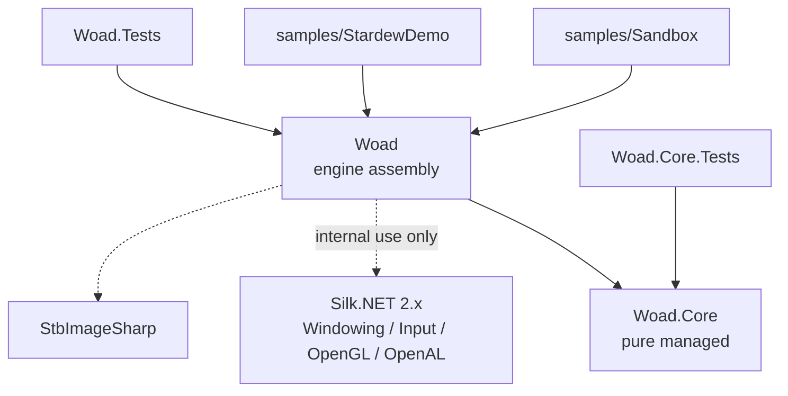
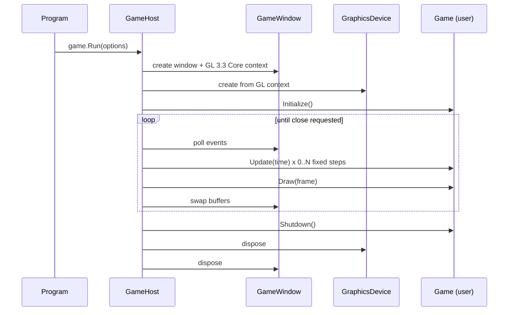

# Woad architecture overview

Status: **Draft v1** (pre-implementation). Decisions referenced here are *Proposed* in the [ADRs](../decisions/README.md) and become *Accepted* in backlog issue M0-08, after the milestone 0 spikes.

## 1. Scope and principles

Woad is a reusable 2D engine: lifecycle, fixed-timestep loop, OpenGL 3.3 Core 2D renderer, input, audio, content and collision utilities. Principles:

1. **Small public API, large internal freedom.** Everything is `internal` unless a game needs it. Public types are `sealed` unless designed for inheritance (only `Game`).
2. **Silk.NET and OpenGL never leak.** Game code sees Woad types and `System.Numerics`.
3. **Main-thread affinity for anything native.** Window, GL, OpenAL and input live on one thread.
4. **Explicit ownership.** Whoever creates a native resource disposes it; leaks are reported in debug builds.
5. **Extract, don't predict.** No entity model, UI toolkit or async pipeline until the demo game proves the need ([ADR 0011](../decisions/0011-scope-guard.md)).
6. **Pure code is separate from native code**, so most logic is unit-testable without a GPU.

## 2. Assemblies and dependency rules



| Assembly | Contains | Must not reference |
|---|---|---|
| `Woad.Core` | Mathematics, collision/geometry, timing (`FixedTimestep`, `GameTime`, `IClock`), configuration records, asset path and cache logic | Silk.NET, OpenGL, OpenAL, any native library, `Woad` |
| `Woad` | `Game`, `GameHost`, `GameContext`, platform/window, input, graphics, audio, content loaders, diagnostics | Samples |
| `samples/Sandbox`, `samples/StardewDemo` | Sandbox, StardewDemo | Silk.NET, internals (public API only) |
| `samples/GraphicsLab` | Low-level scenes for milestone 2 (triangle, texture) | The only sample with `InternalsVisibleTo` access; it exists so Sandbox can stay public-API-only |

Namespaces inside `Woad` mirror the subsystems below. Namespace-level rules (enforced by architecture tests, issue M1-10):

- `Woad.Graphics` does not reference `Woad.Platform`. The host creates the window and hands the GL context to `GraphicsDevice` ([ADR 0005](../decisions/0005-window-context-ownership-and-owned-loop.md)).
- `Woad.Content` references Graphics and Audio only through loader registration, never the other way round.
- No public member of any assembly exposes a `Silk.NET.*` type.
- No static mutable state. No service locator. No DI container ([ADR 0003](../decisions/0003-assembly-layout-and-dependency-rules.md)).

An assembly is split out later only for a concrete reason, for example making audio optional because of its native dependency.

## 3. Subsystems

| Namespace | Assembly | Visibility | Responsibility |
|---|---|---|---|
| `Woad` | Woad | public | `Game`, `GameHost`, `GameContext`, `EngineOptions` (record lives in Core) |
| `Woad.Timing` | Core | public | `FixedTimestep`, `GameTime`, `FrameInfo`, `IClock` |
| `Woad.Mathematics` | Core | public | `Transform2D`, `Rect`, `Color`, helpers over `System.Numerics` |
| `Woad.Collision` | Core | public | Shapes, intersection tests, ray/segment queries |
| `Woad.Platform` | Woad | internal | `GameWindow` (Silk windowing, GL context ownership), event pump |
| `Woad.Input` | Woad | public API, internal Silk glue | Keyboard/mouse state, own `Key` and `MouseButton` enums |
| `Woad.Graphics` | Woad | public API, internal GL | `GraphicsDevice` (internal), `Renderer2D`, `Texture2D`, `Camera2D` |
| `Woad.Audio` | Woad | public API, internal AL | Device, sound effects, music streaming |
| `Woad.Content` | both | public | `ContentManager`, loaders; path and cache logic in Core |
| `Woad.Diagnostics` | Woad | public | `FrameStats`, debug overlay, leak tracker |

Type names are tentative until the relevant epic.

## 4. Lifecycle



Disposal runs in reverse creation order. `Shutdown` runs once, also after an exception (best effort).

## 5. Main loop

```csharp
// Sketch, not final code.
var timer = new FixedTimestep(tickRate: 60, maxFrameDelta: 0.250, maxStepsPerFrame: 5);
while (!window.IsClosing)
{
    window.PollEvents();                       // events are buffered by the input system
    int steps = timer.Advance(clock.Now, out float alpha);
    for (int i = 0; i < steps; i++)
    {
        input.BeginTick();                     // edges latched since last tick become visible
        game.Update(in time);                  // fixed delta
    }
    graphics.BeginFrame();                     // clear
    game.Draw(in frameInfo);                   // alpha available for interpolation
    window.SwapBuffers();
    limiter.Wait();                            // only when vsync is off and a cap is set
}
```

- Fixed 60 Hz by default, accumulator in integer stopwatch ticks (no float drift).
- Frame deltas above 250 ms are clamped and at most 5 steps run per frame, so a stall never causes a spiral of death.
- Pause stops ticking but keeps rendering. The engine exposes `alpha` but does not interpolate automatically.
- See [ADR 0008](../decisions/0008-fixed-timestep-and-input-sampling.md).

## 6. Threading

- One **main thread** owns the window, the GL context, the OpenAL context and input. Debug builds assert this.
- Worker threads may read files and decode images/audio only. They never touch GL or AL.
- Results return to the main thread through a queue drained at the start of each frame. In 0.x all loading is synchronous; the decode/upload split exists so async can be added later ([ADR 0009](../decisions/0009-content-identity-and-sync-first-loading.md)).
- See [ADR 0007](../decisions/0007-threading-and-resource-ownership.md).

## 7. Resource ownership and disposal

- The creator owns a resource and disposes it. `ContentManager` owns everything it loads and disposes it when the manager is disposed.
- No reference counting, no handles (revisit only if the demo hurts).
- `Dispose` is idempotent; use after dispose throws `ObjectDisposedException`.
- GL/AL objects are **never** released from finalizers (wrong thread). Debug builds track live native objects and log leaks at shutdown.

## 8. Error handling

| Situation | Behaviour |
|---|---|
| GL 3.3 Core context cannot be created | `EngineInitializationException` with driver/version details; host cleans up and rethrows |
| Shader compile/link failure | `ShaderCompilationException` with stage, source name and driver log |
| Asset missing or corrupt | `ContentLoadException` with requested path, resolved path and inner exception |
| Audio device missing or fails | Log a warning, fall back to a null audio device, game continues |
| Exception in user `Initialize`/`Update`/`Draw` | Log with tick/frame context, best-effort `Shutdown` and disposal, rethrow the original exception from `Run` |
| Use after dispose | `ObjectDisposedException` |
| Native call from the wrong thread | Debug: `InvalidOperationException`; Release: undefined, documented |

## 9. Conventions

- **Coordinates:** +Y down, origin top-left, 1 world unit = 1 pixel at zoom 1. Rotation in radians, positive = clockwise on screen.
- **Textures:** images are uploaded unflipped, so (0,0) is top-left; source rectangles are in pixels. Nearest-neighbour filtering by default (pixel art). Atlases need padding to prevent bleeding.
- **Color:** `Color` is 8-bit RGBA with straight alpha; default blend is source-alpha / one-minus-source-alpha.
- **Asset paths:** relative, `/` separated, case-exact, rooted at the content directory ([ADR 0009](../decisions/0009-content-identity-and-sync-first-loading.md)).
- Full rationale: [ADR 0006](../decisions/0006-concrete-2d-renderer-and-coordinate-conventions.md).

## 10. Diagnostics

Logging uses `Microsoft.Extensions.Logging.Abstractions`; a minimal console logger is used when none is supplied. `FrameStats` (frame time, FPS, update and draw time) arrives in milestone 1; the debug overlay (draw calls, texture count, loaded assets) in milestone 4. GL error checking is wrapped and enabled in debug builds. RenderDoc is the recommended GPU debugging tool on Windows.

## 11. Testing and platform validation

| What | How | Runs |
|---|---|---|
| Maths, collision, timestep, limiter, asset paths, cache | xUnit, no GL (`Woad.Core.Tests`) | Every PR, Windows and Linux |
| Host lifecycle, disposal order, error handling | xUnit with fake window and fake clock seams (`Woad.Tests`) | Every PR |
| Architecture and public-API rules | Reflection-based tests | Every PR |
| Rendering | Sandbox scenes inspected on Windows | Per milestone |
| Linux | Headless smoke test: Xvfb + Mesa software GL + OpenAL null backend ([ADR 0010](../decisions/0010-supported-platforms-and-linux-validation.md)) | CI (x64) and Raspberry Pi (ARM64) |
| Audio | Manual on Windows; init-only smoke with null device on Linux | Per milestone |

Unit tests are never claimed to verify rendering.

## 12. Deliberately undecided

- Font rasterizer and glyph-atlas approach (bitmap fonts first).
- Async content loading.
- Engine-side interpolation.
- Scene/state API details and any entity model (after the demo prototype).
- Gamepad support and action mapping.
- NuGet package layout (decided at the 1.0 candidate).
